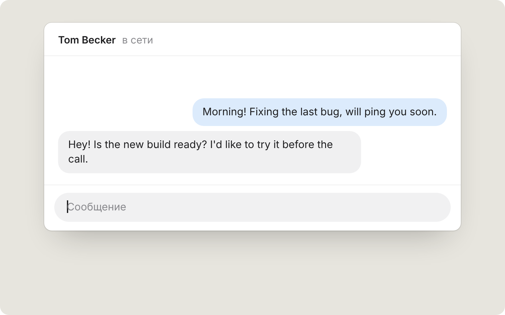
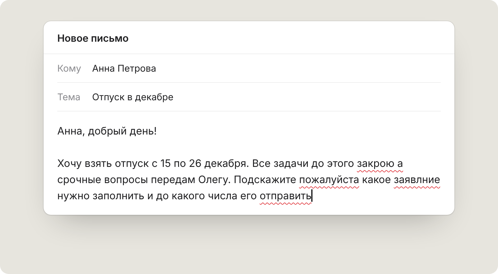
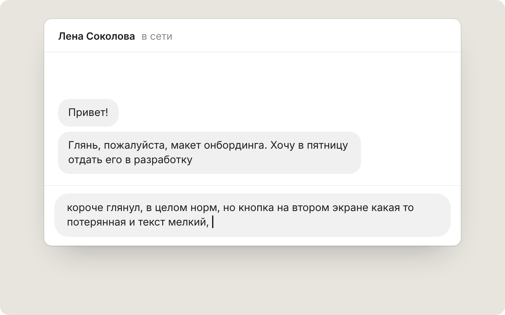
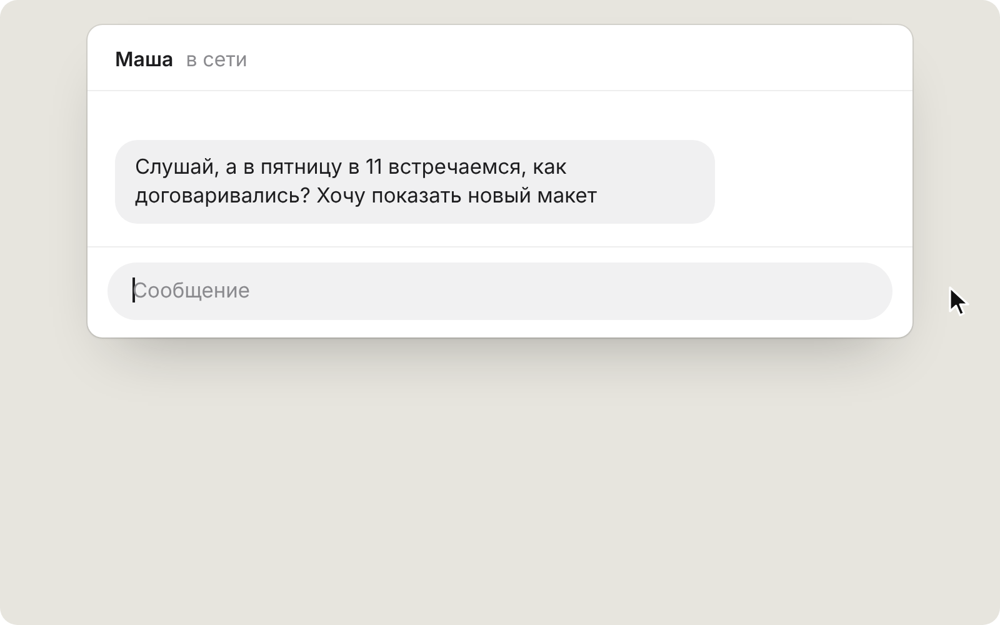
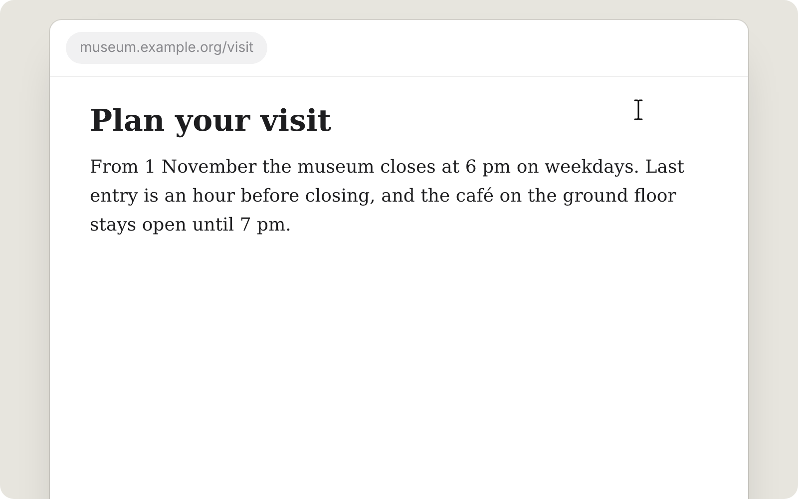
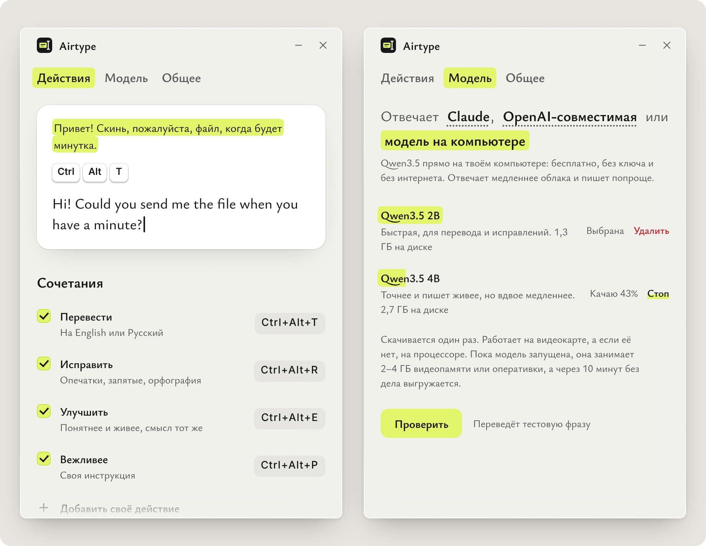

<p align="center">
  
</p>

<h1 align="center">Airtype</h1>

<p align="center">
  Переводчик и редактор для любого поля ввода.<br />
  Пишешь как обычно, жмёшь сочетание клавиш, и текст в поле меняется на перевод или исправленную версию.
</p>

<p align="center">
  <a href="https://github.com/ayato-dev/AirType/releases/latest"><b>Скачать</b></a> для Windows, macOS и Linux
</p>

<picture>
  <source media="(prefers-color-scheme: dark)" srcset="docs/media/translate-dark.webp" />
  
</picture>

Это перевод: `Ctrl+Alt+T` на Windows и Linux, `⌘⌥T` на Mac. Текст на русском уходит на английский, английский переводится на русский. Оба языка меняются в настройках: можно выбрать из списка или вписать любой другой.

Работает в мессенджерах, браузере, почте, редакторах и других приложениях с полем ввода. Ничего не нужно копировать в отдельное окно: текст берётся из поля, где ты печатаешь, и туда же возвращается. Отменить замену можно обычным `Ctrl+Z`.

## Что ещё умеет

### Исправить ошибки

`Ctrl+Alt+R` или `⌘⌥R`. Опечатки, запятые, орфография. Слова и тон остаются твоими, меняется только то, что было с ошибкой.

<picture>
  <source media="(prefers-color-scheme: dark)" srcset="docs/media/fix-dark.webp" />
  
</picture>

### Переписать понятнее

`Ctrl+Alt+E` или `⌘⌥E`. Для сообщений, набранных на бегу: та же мысль, тот же язык и примерно та же длина, но читается спокойно.

<picture>
  <source media="(prefers-color-scheme: dark)" srcset="docs/media/improve-dark.webp" />
  
</picture>

### Написать за тебя

`Ctrl+Alt+Space` или `⌘⌥A` в пустом поле. Под полем открывается панель: пишешь своими словами, что нужно ответить, выбираешь язык и тон. Готовый текст сначала показывается в панели, а «Вставить» ставит его в поле. Панель появляется плавно и закрывается как меню: по Esc, по клику мимо или когда переключаешься в другое окно. Если закрыть её, пока модель думает, запрос отменяется.

<picture>
  <source media="(prefers-color-scheme: dark)" srcset="docs/media/compose-dark.webp" />
  
</picture>

### Прочитать на своём языке

Выдели текст где угодно, даже на сайте, где его не поменять, и нажми то же `Ctrl+Alt+Space`. Панель предложит перевести, исправить, улучшить, сделать твоё действие или то, что впишешь сам. Панель встаёт прямо под выделенным текстом, а если программа не говорит, где он (Telegram, многие чаты), то под мышкой. Ответ можно скопировать, а если текст был в поле ввода, заменить им выделенное.

<picture>
  <source media="(prefers-color-scheme: dark)" srcset="docs/media/read-dark.webp" />
  
</picture>

### Свои действия и модель

В настройках можно добавить своё действие со своей инструкцией и своим сочетанием, например «сделай вежливее и короче». Там же меняются сочетания, языки и модель: Claude, любой сервис с API как у OpenAI или Qwen прямо на компьютере, без ключа и без интернета.

<picture>
  <source media="(prefers-color-scheme: dark)" srcset="docs/media/settings-dark.webp" />
  
</picture>

## Где пригодится

| Ситуация | Что нажать |
|---|---|
| Переписка с коллегой или клиентом на другом языке | `Ctrl+Alt+T` прямо в поле сообщения |
| Письмо или заявление перед отправкой | `Ctrl+Alt+R` |
| Сообщение набрано на бегу и читается коряво | `Ctrl+Alt+E` |
| Надо ответить, а слова не складываются: отказ, перенос встречи, напоминание об оплате | `Ctrl+Alt+Space` в пустом поле |
| Сайт, документация, отзыв или письмо от поддержки на чужом языке | выделить и `Ctrl+Alt+Space` |
| Одна и та же правка много раз в день: короче, на «вы», по-деловому | своё действие со своим сочетанием |
| Нет интернета или текст не должен уходить в облако | модель на компьютере |

## Установка

Установщики лежат в [последнем релизе](https://github.com/ayato-dev/AirType/releases/latest).

| Система | Файл |
|---|---|
| Windows 10 и 11 | `Airtype_…_x64-setup.exe`, ставится без прав администратора, или `Airtype_…_x64_en-US.msi` |
| macOS 11 и новее, Intel и Apple Silicon | `Airtype_…_universal.dmg` |
| Linux на X11, Ubuntu 22.04 и новее, Debian | `Airtype_…_amd64.deb` |
| Linux на X11, любой дистрибутив | `Airtype_…_amd64.AppImage` |

С версии 0.3.0 Airtype обновляется сам: при запуске и потом раз в 12 часов он проверяет последний релиз, и если вышла новая версия, в трее и в настройках появляется «Обновить». Скачивает, ставит и перезапускается сам, а обновление подписано, так что подменить его по дороге нельзя. С 0.2.x на 0.3.0 установщик нужно поставить руками последний раз. Установка из `.deb` так не обновляется, её обновляют новым `.deb`. На Windows обновление ставится установщиком `.exe`, даже если Airtype ставили из `.msi`.

После установки Airtype живёт в трее. Открой настройки, вставь ключ API или скачай модель на компьютер, и можно жать сочетания в любом поле.

Сборки пока не подписаны, поэтому при первом запуске система предупредит.

**Windows.** SmartScreen скажет про неизвестного издателя: «Подробнее», затем «Выполнить в любом случае».

**macOS.** Перетащи Airtype в «Программы» и выполни один раз в Терминале:

```sh
xattr -cr /Applications/Airtype.app
```

Потом дай Airtype «Универсальный доступ» в «Системные настройки → Конфиденциальность и безопасность». Без него приложение не может нажимать `⌘C` и `⌘V` за тебя. Пока сборка подписана ad-hoc, macOS считает каждое обновление новым приложением, и доступ приходится выдавать заново.

**Linux.** Работает только в сессии X11, на Wayland сочетания клавиш не сработают. AppImage сначала сделай запускаемым: `chmod +x Airtype_*.AppImage`.

## Сочетания

| Windows и Linux | macOS | Что делает |
|---|---|---|
| `Ctrl+Alt+T` | `⌘⌥T` | Перевести на твой язык (English по умолчанию), а текст, который уже на нём, на второй (Русский) |
| `Ctrl+Alt+R` | `⌘⌥R` | Исправить орфографию, грамматику и пунктуацию |
| `Ctrl+Alt+E` | `⌘⌥E` | Улучшить: переписать понятнее и естественнее |
| `Ctrl+Alt+Space` | `⌘⌥A` | Панель под полем: «напиши за меня» или действия с выделенным текстом |

Если в поле выделен кусок, обработается только он. Если ничего не выделено, Airtype возьмёт всё содержимое поля, где стоит курсор. Пока модель думает, под полем висит ярлычок (если места снизу нет, то над полем). Все сочетания меняются в настройках.

## Модель и ключ

Airtype работает с твоим собственным ключом. Ключ хранится в системной связке ключей (Keychain на macOS, диспетчер учётных данных на Windows, GNOME Keyring или KWallet на Linux), а не в файле.

- **Claude.** Ключ берётся в [консоли Anthropic](https://platform.claude.com/settings/keys). По умолчанию стоит `claude-haiku-5-5` с низким усилием: он отвечает быстрее всех и стоит в разы дешевле. Если важнее качество текста, выбери `claude-opus-5-5`.
- **OpenAI-совместимый.** OpenAI, OpenRouter (`https://openrouter.ai/api/v1`), локальные Ollama (`http://localhost:11434/v1`) и LM Studio. Для локальной модели ключ не нужен. Ключ уходит только по `https`, по `http` можно ходить лишь на `localhost`.
- **Модель на компьютере.** Qwen3.5 2B (1,3 ГБ) или 4B (2,7 ГБ) через [llama.cpp](https://github.com/ggml-org/llama.cpp), скачивается прямо из настроек. Работает на видеокарте (на Windows и Linux через Vulkan, то есть на любой NVIDIA, AMD или Intel с обычным драйвером, на Mac с Apple Silicon через Metal), а без неё на процессоре. Пока модель запущена, она занимает 2–4 ГБ видеопамяти или оперативки, а через 10 минут без дела выгружается. Если модель не успела загрузиться на видеокарту, Airtype перезапускает её на процессоре. Видеокарту можно выключить переключателем «Аппаратное ускорение»: модель перейдёт на процессор, а видеопамять освободится сразу.

Если API Anthropic недоступен из твоей страны, включи VPN, укажи свой прокси в «Модель → Свой адрес API» или используй OpenRouter.

Текст уходит только в выбранный тобой API. Буфер обмена после вставки возвращается как был, со всеми форматами: картинки, файлы, форматированный текст. Поля паролей Airtype пропускает.

## Разработка

Нужны Rust (stable), Node.js 22 и [системные зависимости Tauri](https://tauri.app/start/prerequisites/).

```sh
npm install
npm run tauri dev     # запуск с горячей перезагрузкой интерфейса
npm run tauri build   # установщик в src-tauri/target/release/bundle
cd src-tauri && cargo test
```

Новый релиз делается тегом: подними версию в `package.json`, `src-tauri/Cargo.toml` и `src-tauri/tauri.conf.json`, затем `git tag v0.3.0 && git push origin v0.3.0` или на вкладке **Actions** открой **build**, **Run workflow** с галочкой «release». GitHub Actions соберёт установщики на трёх системах, подпишет обновления и сам опубликует релиз вместе с `latest.json`, по которому приложение узнаёт о новой версии. Для подписи в секретах репозитория должен лежать закрытый ключ `TAURI_SIGNING_PRIVATE_KEY` (и `TAURI_SIGNING_PRIVATE_KEY_PASSWORD`, если у ключа есть пароль), парный открытому из `plugins.updater.pubkey` в `tauri.conf.json`. Без ключа сборка установщиков падает. Текст релиза берётся из `.github/release-notes.md`. Сборки с каждого пуша в `main` тоже есть: вкладка **Actions**, запуск **build**, артефакты.

Анимации и картинки в этом README нарисованы настоящими стилями приложения: сцены лежат в `docs/scenes`, окна Airtype в них загружают `src/styles`, а окно настроек это собранная страница настроек. После правок интерфейса их можно перерисовать командой `node docs/scenes/render.cjs` (нужны Playwright с Chromium и ffmpeg с libwebp).

<details>
<summary><b>Подпись для macOS</b></summary>

Чтобы «Универсальный доступ» и Keychain переживали обновления, нужна подпись Developer ID и нотаризация. Это делается один раз в своём аккаунте Apple Developer: получить сертификат «Developer ID Application», положить его и данные для нотаризации в секреты репозитория (`APPLE_CERTIFICATE`, `APPLE_CERTIFICATE_PASSWORD`, `APPLE_SIGNING_IDENTITY`, `APPLE_ID`, `APPLE_PASSWORD`, `APPLE_TEAM_ID`), передать их в шаг `tauri build` и убрать `"signingIdentity": "-"` из `tauri.conf.json`. Подробно: https://v2.tauri.app/distribute/sign/macos/

</details>

<details>
<summary><b>Как устроено</b></summary>

Ядро на Rust (Tauri 2), интерфейс на чистом TypeScript без фреймворков.

```
src-tauri/src/
  engine.rs   один прогон: берём текст, зовём модель, ставим ответ на место
  panel.rs    панель под полем: «напиши за меня» и действия с выделенным
  local.rs    модель на компьютере: скачивание llama.cpp и Qwen, запуск сервера
  popup.rs    где показать ярлычок и панель: под текстом, над ним или под мышкой
  glass.rs    стекло под окнами (acrylic на Windows) и плавное появление панели
  field.rs    текст поля через accessibility API (AX на macOS, UI Automation на Windows)
  input.rs    нажатия Ctrl/Cmd+C, A, V по физическим кодам клавиш (работает в любой раскладке; на Linux через XTest)
  clipboard.rs снимок буфера обмена со всеми форматами и возврат как было
  llm.rs      Claude Messages API, OpenAI-совместимый chat/completions и модель на компьютере
  hotkeys.rs  глобальные сочетания, срабатывают на отпускание клавиши
  hud.rs      ярлычок под полем, который никогда не забирает фокус
  update.rs   обновления из релизов: проверка, скачивание, установка
  config.rs   настройки (JSON в папке приложения) и ключи (системная связка ключей)
  tray.rs     иконка в трее: настройки, пауза, выход
src/          окно настроек, ярлычок и панель (TypeScript + CSS)
design/       исходники иконки и значка в трее
docs/scenes/  сцены для анимаций в README
```

Окно настроек на macOS стоит на системном стекле (Liquid Glass в macOS 26, на старых версиях обычная полупрозрачная подложка), на Windows на acrylic. Идея интерфейса взята у корректора: единственный цвет это маркер, выбранное выделено им, а в замечаниях проблемное место подчёркнуто волной, как опечатка. Шрифт Ysabeau Office лежит внутри приложения (`src/assets/fonts`, лицензия OFL), сеть для интерфейса не нужна.

Текст Airtype сначала спрашивает у самого поля через accessibility API: так буфер обмена не трогается, видно, выделено что-то или нет, а поля паролей пропускаются совсем. На macOS ответ тоже пишется прямо в поле (в веб-страницах вставкой, так страница его точно заметит). Короткий ответ в одну строку Airtype просто печатает, как будто набираешь его сам. Длинный на Windows вставляется через `Ctrl+V`, чтобы работала отмена, но в буфер обмена кладётся только обещание: текст отдаётся в момент, когда приложение его попросит, и сразу после этого буфер возвращается как был, так что скопированное раньше не теряется. Если приложение не рассказывает о своих полях, Airtype по-старому жмёт `Ctrl/Cmd+C` и тут же возвращает буфер обратно, ещё до запроса к модели. А если текст поменялся, пока модель думала, или вставить некуда, ответ не вставляется поверх, а показывается в панели, откуда его можно скопировать.

Временные данные в буфере помечаются так, чтобы не попадать в историю (Win+V и менеджеры буфера на macOS). Если ответ модели обрезан по лимиту, он не вставляется.

Окно настроек создаётся, только когда его открываешь, и закрывается полностью, так что в фоне Airtype не держит лишний веб-движок. Если файл настроек не прочитался, Airtype откладывает его рядом и говорит об этом, а не затирает.

</details>

## Ограничения

- В терминалах Airtype работает только с выделенным текстом: на Windows `Ctrl+C` без выделения прервал бы запущенную программу, а `Ctrl+A` взял бы всю историю. Встроенные терминалы редакторов (VS Code и т. п.) так не распознаются. На Linux в терминалах Airtype копирует и вставляет через `Ctrl+Shift+C`/`Ctrl+Shift+V`, а в xterm и urxvt не работает: там нет сочетания, которое копирует и не прерывает программу.
- На Windows из буфера не восстанавливаются форматы, которые хранят не данные, а дескрипторы GDI (метафайлы, палитры); картинка возвращается как `CF_DIB`.
- Путь через accessibility API ещё не проверен вживую на разных приложениях; Electron-приложения на macOS Airtype на время одного действия просит построить дерево доступности, а потом выключает его обратно.
- Linux работает только в сессии X11: там сочетания ловятся через X, а `Ctrl+C`/`Ctrl+V` нажимаются через XTest. На Wayland система не даёт приложениям ни ловить глобальные сочетания, ни нажимать клавиши за тебя, так что там Airtype сработает лишь в приложениях под XWayland. Текст из полей берётся только через буфер обмена, и после вставки в нём восстанавливается только текст.
